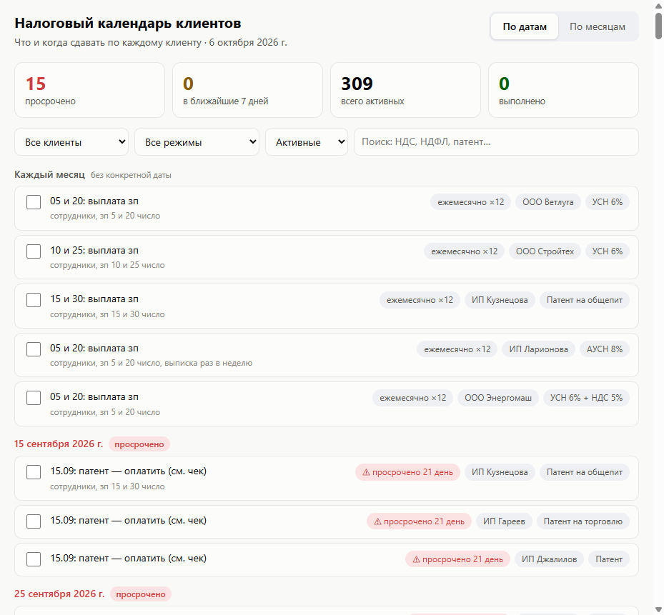
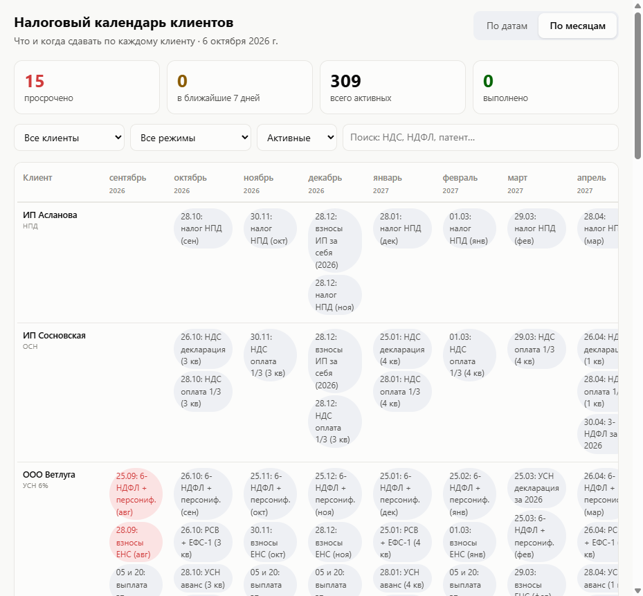

# 📅 Налоговый календарь клиентов

Дашборд для бухгалтера, который ведёт несколько клиентов на разных налоговых режимах:
в одном окне видно, **что и когда сдавать или платить** по каждому клиенту — и что горит прямо сейчас.

## Проблема

Бухгалтер на подряде ведёт 10–15 клиентов: ИП на НПД и патенте, ООО на УСН 6% и 15%, ОСН, АУСН.
У каждого свои декларации, взносы, зарплатные сроки, НДС. В Excel-таблице дедлайны теряются,
просрочка стоит денег клиенту и репутации бухгалтеру.

## Пользователь

Бухгалтер, ведущий несколько организаций и ИП одновременно; подходит и собственному бухгалтеру
маленькой компании.

## Что делает

- **На входе:** выгрузка плана по клиентам (лист «План помесячно» Excel-таблицы → `data/data.js`).
- **На выходе:** два вида — лента «По датам» (просрочено → 7 дней → дальше) и матрица «По месяцам» (клиент × месяц);
  плитки-счётчики (просрочено / ближайшие 7 дней / активные / выполнено); фильтры по клиенту, режиму, статусу и поиск.
- Отметка «выполнено» кликом, сохраняется в браузере (localStorage).
- Ноль установки: чистые HTML + CSS + JS, открывается локально.

## Запуск

Вариант 1 — просто открыть файл:

```
index.html
```

Вариант 2 — локальный сервер (для скриншотов и демо):

```bash
npx serve .
```

или любая статика (python -m http.server, Live Server в VS Code).

## Структура проекта

```
tax-calendar/
├── index.html          # страница дашборда
├── styles.css          # оформление
├── app.js              # логика: фильтры, два вида, статусы
├── data/data.js        # данные: клиенты, режимы, задачи из Excel
├── screenshots/        # скриншоты работающего приложения
└── skills/             # скилл проекта для Claude Code
```

## Данные

`data/data.js` — это одна строка `window.TAX_DATA = {...}`:
список клиентов (имя, режим, примечание) и задач (клиент, месяц, дата, текст, статус).
Имена клиентов вымышленные. Чтобы завести свои данные — отредактируйте объект или соберите его
из своей Excel-таблицы.

## Что дальше (за пределами MVP)

- импорт прямо из .xlsx без ручной выгрузки;
- экспорт «письмо клиенту» по списку предстоящих сроков;
- напоминания за N дней.

## Скриншоты


